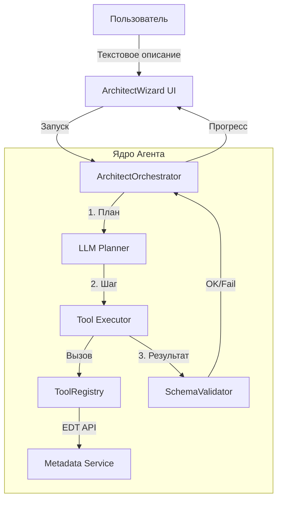

# RFC: Агент-Архитектор (AI System Architect Agent)

**Статус:** Draft  
**Дата:** 2024-05-21  
**Автор:** AI Assistant  
**Связанный проект:** codepilot1c-edt  

---

## 1. Резюме (Executive Summary)

Данный документ описывает архитектуру и план реализации компонента **«Агент-Архитектор»**. 
Этот агент позволяет пользователю вводить высокоуровневое описание бизнес-сущности (например, «Создай подсистему управления складами со справочником номенклатуры и документом поступления»), после чего автоматически генерирует полную структуру метаданных, формы и базовый код BSL.

**Цель:** Снизить порог входа для разработки сложных конфигураций и ускорить создание типовых подсистем за счет использования LLM для оркестрации существующих инструментов создания метаданных.

---

## 2. Проблема и Мотивация

### Текущее состояние
Пользователь может использовать отдельные инструменты (`CreateMetadataTool`, `CreateFormTool`) через чат, но ему необходимо:
- Самостоятельно планировать порядок создания объектов.
- Вручную указывать связи между объектами (реквизиты, табличные части).
- Контролировать целостность создаваемой структуры.

### Желаемое состояние
Пользователь описывает задачу на естественном языке. Агент:
1. Декомпозирует задачу на план.
2. Последовательно выполняет шаги с проверкой зависимостей.
3. Откатывает изменения при ошибке валидации.
4. Предоставляет готовую к работе подсистему.

---

## 3. Архитектурное решение

Агент строится по паттерну **ReAct (Reason + Act)** с использованием существующего реестра инструментов.

### 3.1. Компонентная схема



### 3.2. Переиспользуемые компоненты (Existing)

Следующие классы используются без изменений или с минимальной адаптацией:

| Компонент | Пакет | Роль |
| :--- | :--- | :--- |
| `ToolRegistry` | `com.codepilot1c.core.tools` | Реестр доступных действий |
| `CreateMetadataTool` | `com.codepilot1c.core.tools.metadata` | Создание объектов 1С |
| `AddMetadataChildTool` | `com.codepilot1c.core.tools.metadata` | Добавление реквизитов/табличных частей |
| `UpdateMetadataTool` | `com.codepilot1c.core.tools.metadata` | Модификация свойств |
| `CreateFormTool` | `com.codepilot1c.core.tools.forms` | Генерация форм |
| `ILlmProvider` | `com.codepilot1c.core.llm` | Провайдер модели для планирования |
| `AgentContext` | `com.codepilot1c.core.agent` | Хранение истории и состояния |

---

## 4. Новые компоненты (To Implement)

Необходимо разработать следующие классы для реализации логики агента.

### 4.1. `ArchitectAgent.java`
**Пакет:** `com.codepilot1c.core.agent.architect`  
**Ответственность:** Главный контроллер, управляющий жизненным циклом сессии архитектора.

```java
public class ArchitectAgent {
    private final ILlmProvider llmProvider;
    private final ToolRegistry toolRegistry;
    private final SchemaValidator validator;

    /**
     * Запускает процесс проектирования.
     * @param userPrompt Описание задачи от пользователя.
     * @param projectRoot Корень проекта EDT.
     */
    public CompletableFuture<ArchitectResult> design(String userPrompt, IProject projectRoot);
    
    // Внутренний метод для выполнения шага плана
    private CompletableFuture<StepResult> executeStep(ArchitectStep step, AgentContext context);
}
```

### 4.2. `ArchitectPlan.java` & `ArchitectStep.java`
**Пакет:** `com.codepilot1c.core.agent.model`  
**Ответственность:** Структуры данных для хранения плана работ.

```java
public class ArchitectPlan {
    private String goal;
    private List<ArchitectStep> steps;
    private boolean validated;
}

public class ArchitectStep {
    public enum StepType { CREATE_OBJECT, ADD_ATTRIBUTE, CREATE_FORM, GENERATE_CODE }
    
    private StepType type;
    private String toolName; // Например, "create_metadata"
    private Map<String, Object> parameters;
    private String dependsOn; // ID шага, который должен выполниться ранее
    private StepStatus status;
}
```

### 4.3. `SchemaValidator.java`
**Пакет:** `com.codepilot1c.core.validation`  
**Ответственность:** Проверка логической целостности после каждого шага (до коммита в рабочую копию).

```java
public class SchemaValidator {
    /**
     * Проверяет, не нарушает ли изменение целостность конфигурации.
     * Например: ссылается ли реквизит на несуществующий тип.
     */
    public ValidationResult validate(IProject project, ArchitectStep lastStep);
    
    // Метод для отката последнего шага при ошибке
    public void rollback(IProject project, ArchitectStep step);
}
```

### 4.4. `ArchitectPrompts.java`
**Пакет:** `com.codepilot1c.core.prompts`  
**Ответственность:** Управление системными промптами для перевода LLM в режим архитектора.

**Пример системного промпта (`system_architect.md`):**
```markdown
Ты — старший архитектор 1С:Предприятие. Твоя задача — превратить описание пользователя в пошаговый план создания метаданных.
Используй только следующие инструменты: [список инструментов].
Правила:
1. Сначала создавай Подсистему.
2. Затем создавай Основные объекты (Справочники, Документы).
3. Добавляй реквизиты и табличные части только после создания объекта.
4. Формы создавай в конце.
5. Если пользователь не указал тип, выбирай наиболее подходящий по контексту.
Выведи ответ строго в формате JSON списка шагов.
```

### 4.5. `LaunchArchitectWizard.java`
**Пакет:** `com.codepilot1c.ui.wizards`  
**Ответственность:** UI диалог для ввода запроса и отображения прогресс-бара.

---

## 5. Паттерны реализации и Workflow

### 5.1. Паттерн "Chain of Thought Planning"

LLM не генерирует код сразу. Она генерирует **план**, который парсится в `ArchitectPlan`.

**Workflow:**
1. **Input:** "Нужен складской учет: товары и приходные накладные."
2. **LLM Planning:**
   ```json
   [
     {"id": 1, "tool": "create_metadata", "args": {"name": "Warehousing", "type": "Subsystem"}},
     {"id": 2, "tool": "create_metadata", "args": {"name": "Products", "type": "Catalog", "parent": "Warehousing"}},
     {"id": 3, "tool": "add_child", "args": {"object": "Products", "childType": "Attribute", "name": "Article", "type": "String"}},
     {"id": 4, "tool": "create_metadata", "args": {"name": "PurchaseOrder", "type": "Document", "parent": "Warehousing"}},
     {"id": 5, "tool": "add_child", "args": {"object": "PurchaseOrder", "childType": "TabularSection", "name": "Goods"}}
   ]
   ```
3. **Execution Loop:**
   - Для каждого шага вызывается `toolRegistry.execute()`.
   - После выполнения вызывается `validator.validate()`.
   - При успехе -> следующий шаг.
   - При ошибке -> попытка исправления (retry) или откат (rollback).

### 5.2. Обработка ошибок и Откат

Критически важный компонент. Поскольку изменение метаданных в EDT — операция тяжелая, необходим механизм отката.

**Стратегия:**
- Использовать `IWorkspaceEdit` (если поддерживается EDT API) для группировки изменений.
- Либо сохранять снапшоты имен объектов перед созданием и удалять их при неудаче (`DeleteMetadataTool`).

```java
// Псевдокод обработки ошибки
try {
    await executor.run(step);
    if (!validator.verify(step)) {
        throw new ValidationException("Нарушение целостности");
    }
} catch (Exception e) {
    logger.error("Шаг failed", e);
    if (step.isCritical()) {
        rollbackEngine.undoToCheckpoint(plan.getCheckpointId());
        return ArchitectResult.failed(e.getMessage());
    }
}
```

---

## 6. Интерфейсы взаимодействия (API)

### 6.1. Входные данные (Input DTO)

```java
public class ArchitectRequest {
    private String naturalLanguageDescription;
    private String targetProjectPath;
    private boolean createGitCommit; // Флаг создания коммита после успеха
    private GenerationMode mode; // DRAFT (только план) или EXECUTE (реальное создание)
}
```

### 6.2. Выходные данные (Output DTO)

```java
public class ArchitectResult {
    private boolean success;
    private List<String> createdObjects; // Список путей к созданным объектам
    private String logSummary;
    private ArchitectPlan executedPlan;
    private List<ValidationError> errors;
}
```

---

## 7. План реализации (Roadmap)

1. **Фаза 1: Прототип (Core Logic)**
   - Реализовать `ArchitectPlan` и парсинг JSON от LLM.
   - Написать простой цикл выполнения шагов без валидации.
   - Интеграция с существующими `CreateMetadataTool`.

2. **Фаза 2: Валидация и Надежность**
   - Внедрить `SchemaValidator`.
   - Реализовать механизм отката (Rollback).
   - Добавить обработку зависимостей (DAG execution).

3. **Фаза 3: Пользовательский интерфейс**
   - Создать `LaunchArchitectWizard`.
   - Добавить визуализацию прогресса (Progress Monitor).
   - Интеграция в меню контекста проекта.

4. **Фаза 4: Расширение возможностей**
   - Поддержка генерации кода модулей объектов.
   - Поддержка сложных связей (планы видов характеристик).
   - Сохранение шаблонов архитектурных паттернов.

---

## 8. Риски и Ограничения

- **Галлюцинации LLM:** Модель может придумать несуществующие типы данных или нарушить синтаксис имен 1С. 
  *Митигация:* Строгая валидация схемы перед применением и использование few-shot промптов с примерами корректных структур.
- **Производительность:** Создание множества объектов метаданных может заморозить интерфейс EDT.
  *Митигация:* Выполнение в фоне с асинхронным обновлением UI.
- **Конфликты слияния:** Автоматические изменения могут конфликтовать с ручной работой разработчика.
  *Митигация:* Работа в отдельной ветке Git или предупреждение о блокировке проекта.

---

## 9. Заключение

Реализация «Агента-Архитектора» возможна за счет комбинации мощных возможностей генерации планов LLM и детерминированных инструментов манипуляции метаданными, уже присутствующих в проекте `codepilot1c-edt`. Ключевой задачей является создание надежного слоя оркестрации и валидации, который гарантирует целостность конфигурации 1С.
